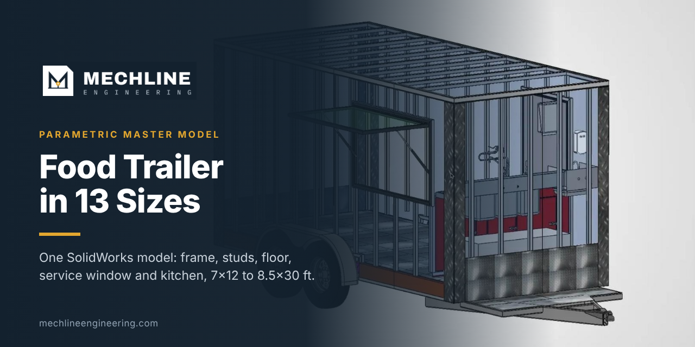

# Parametric Food Trailer Model: 13 Sizes, One SolidWorks Model

One parametric SolidWorks master model that regenerates the frame, wall studs, floor, service window and kitchen line for **13 standard food trailer sizes, from 7 × 12 to 8.5 × 30 ft**. It comes with plan layouts and equipment schedules for builders.

## One model, every size

| 7 × 12 ft | 7 × 16 ft | 8.5 × 16 ft |
|---|---|---|
|  |  |  |
| **8.5 × 20 ft** | **8.5 × 28 ft** | **8.5 × 30 ft** |
|  |  |  |

## What the model covers

| | |
|---|---|
| Sizes | 13 standard sizes, 7 × 12 to 8.5 × 30 ft |
| Axles | Single, tandem and triple |
| Structure | Steel RHS/SHS frame and wall studs |
| Body | Aluminium skin, checker-plate floor and lower panels |
| Fit-out | Service window, kitchen line, sinks and equipment positions |
| Layout practice | US health-department layout practice, imperial units |
| Output | Parametric 3D CAD, plan layouts, equipment schedules, BOMs |

## Layouts for builders

| Plan layout | Equipment schedule |
|---|---|
|  |  |

## Automation on top of the model

- **[Size configurator](https://github.com/mechline-engineering/solidworks-trailer-configurator):** pick a size and the whole trailer rebuilds in seconds.
- **[Automatic steel cut list](https://github.com/mechline-engineering/solidworks-steel-cut-list):** every member, length, miter angle and quantity exported to Excel in one click.

## Source files

This repository is a showcase. The master model and layouts are used in production, so the CAD files are not public.

**Food truck or trailer builder?** We can set up a parametric model like this for your own range, or produce drawing packages for individual builds.

## Contact

**Mechline Engineering** – mechanical design, FEA and contract manufacturing for manufacturers in the US, Europe and Australia.

- Website: https://www.mechlineengineering.com
- Quote request: https://www.mechlineengineering.com/#quote
- Email: info@mechlineengineering.com
